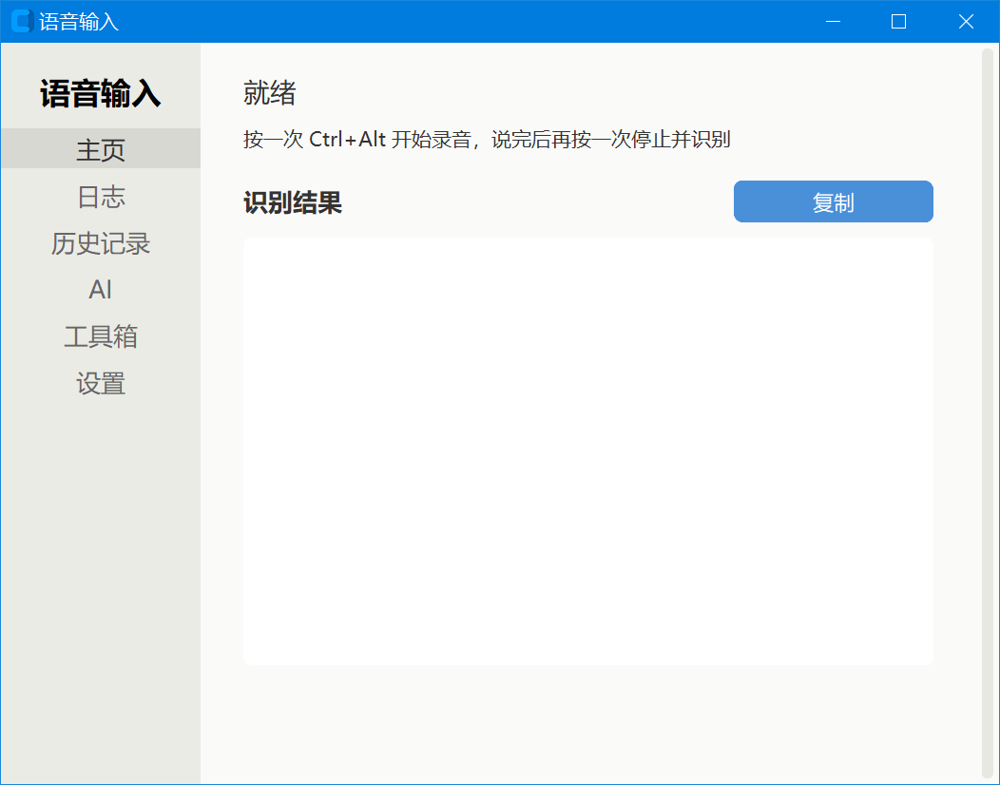
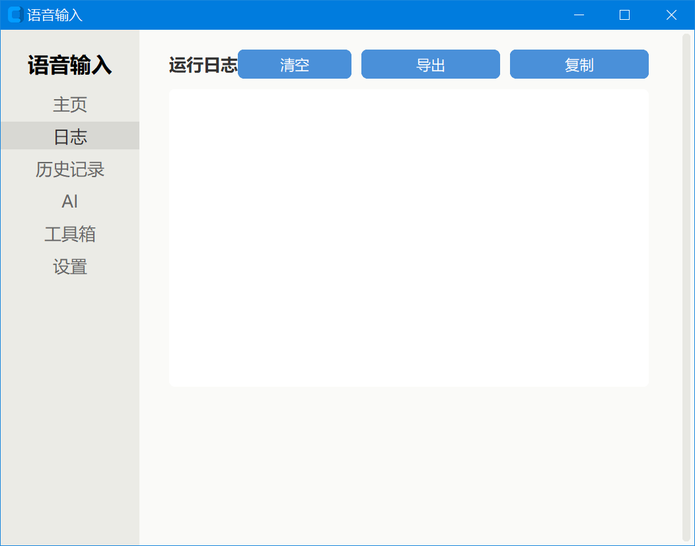
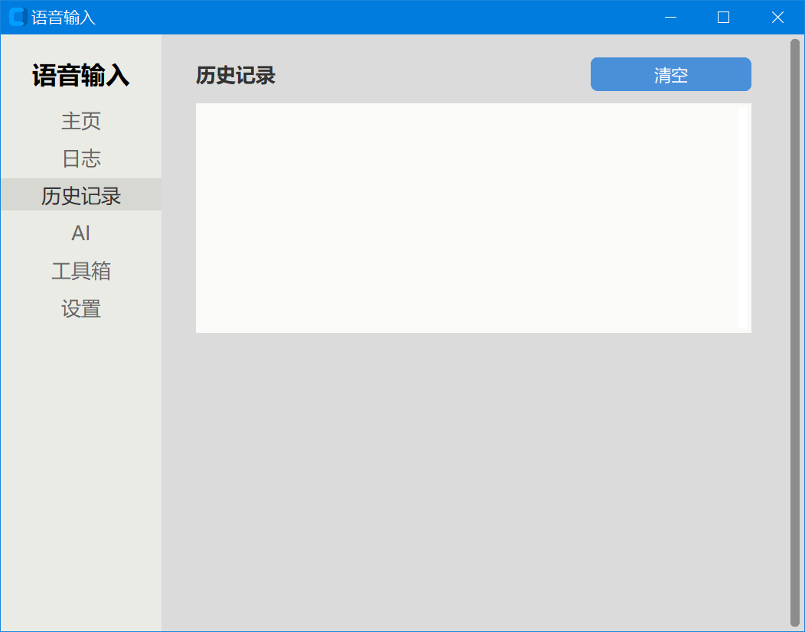
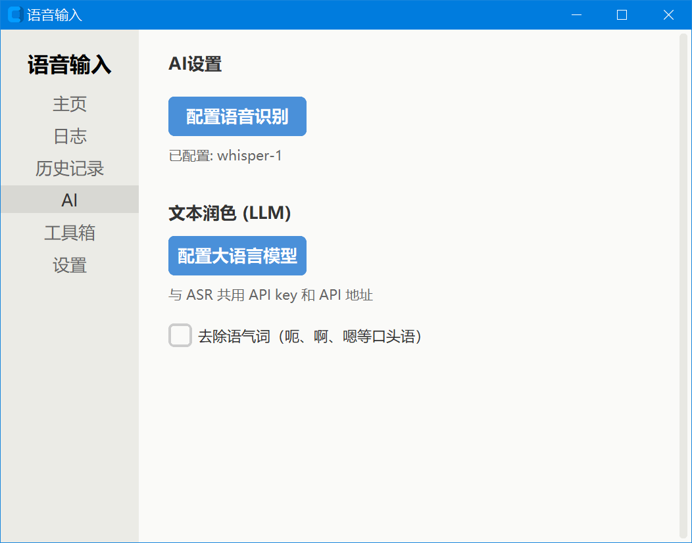
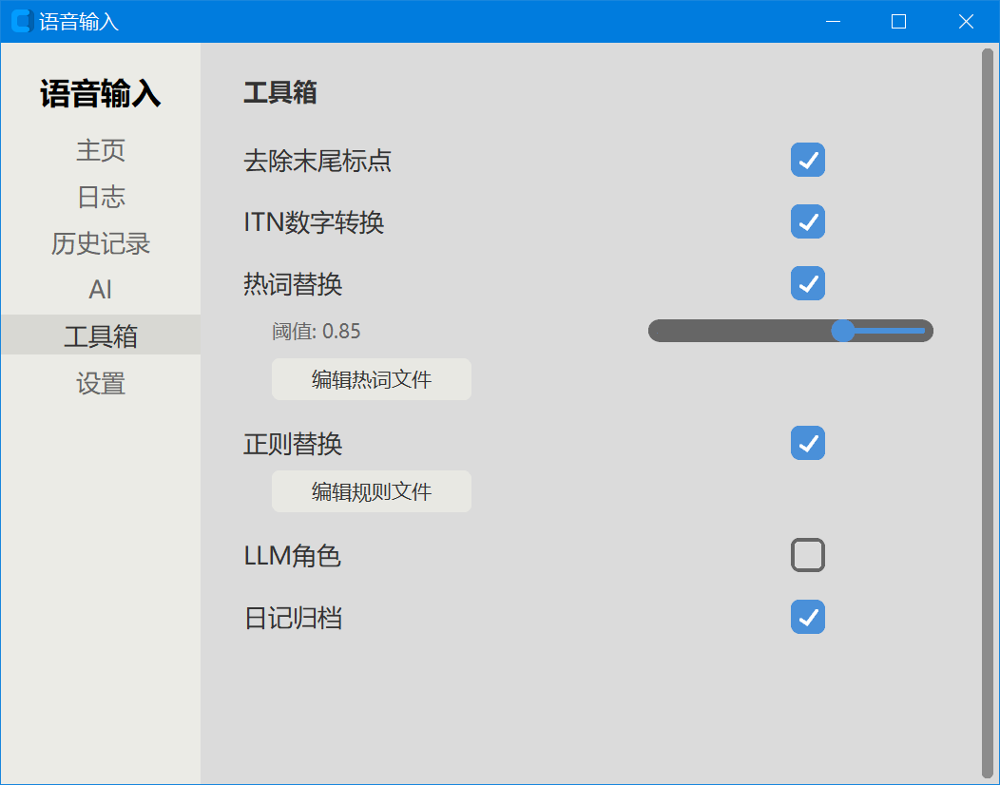
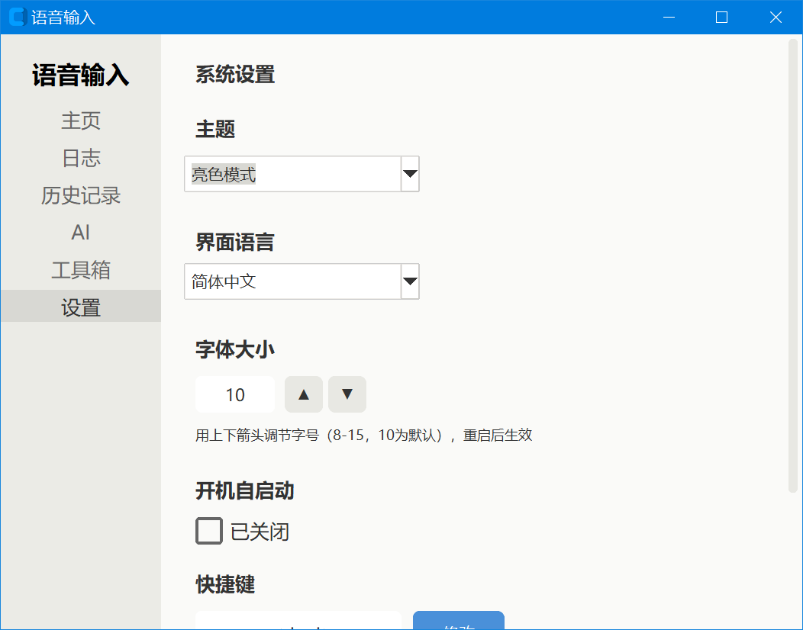
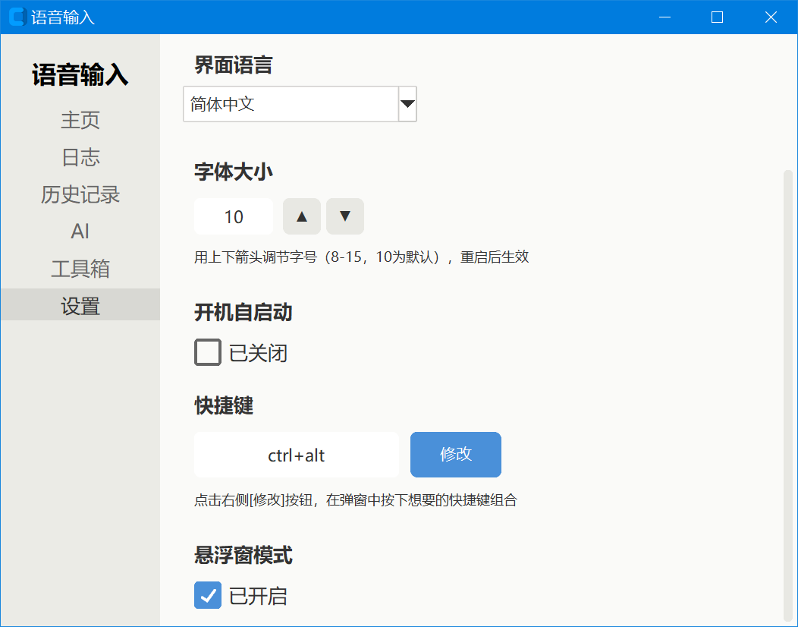

[中文](README_zh.md) | [English](README.md) | [日本語](README_ja.md) | [한국어](README_ko.md) | [Русский](README_ru.md) | [Español](README_es.md) | [Français](README_fr.md) | [Deutsch](README_de.md) | [Português](README_pt.md)

# Voice Input Tool — User Guide

## I. Software Introduction

This is a Windows voice input method that connects to a third-party ASR (speech recognition) API. Press the hotkey to start recording, press it again to stop recording, and the recognized text is automatically typed at the current cursor position.

## Interface Preview

**Home page** — recording status and the most recent recognition result

**Log** — real-time program logs (recording, recognition, post-processing)

**History** — browse past recognition records

**AI Configuration** — ASR provider, API key, model name

**Toolbox** — centralized switches for text post-processing

**Settings (part 1)** — hotkey, theme, font size, interface language

**Settings (part 2)** — auto-start on boot, floating window, etc.

## II. Core Features

- Voice to text: trigger recording via a global hotkey; recognition result is automatically pasted at the cursor position
- Multi-provider support: supports three ASR services — OpenAI-compatible format, Doubao large model, and Volcengine
- Floating window: shows real-time status while recording (with a thin theme-colored border); results are auto-copied to clipboard and pasted
- History: automatically saves each recognition result, supports paragraph indentation display
- Multilingual UI: 35 built-in interface languages, each matched to the most suitable font
- Theme switching: light / dark themes, all widget colors refreshed consistently
- Font size adjustment: adjust the font-size level (8 ~ 15, default 10) via up/down arrows; affects only fonts, not widgets
- Custom hotkey: click the "Modify" button and press a key combination in the popup to capture it; supports 1 ~ 3 key combinations
- Hotword replacement: write rare words into the hotword list; forced replacement via phonetic fuzzy matching
- Regex rule replacement: precisely replace specified text via equations or regex rules
- ITN number conversion: auto-converts "fifteen or six" into "15~16", supporting ranges, dates, percentages, fractions, etc.; built-in protection words prevent false conversions like "a while" or "the same"
- Filler-word removal: automatically removes spoken fillers like "uh, ah, hmm" (local processing, does not depend on LLM)
- LLM role processing: when a recognition result starts with a role name, it is handled by the corresponding large-model role (polishing, translation, assistant, etc.); role files are safely parsed via AST, only literal assignments allowed
- Voice commands: say "undo", "newline", "backspace" and other commands to auto-execute the corresponding action
- Diary archive: saves each voice input and recognition result by date
- Auto-start on boot: optional automatic launch on startup
- System tray: minimize to tray; left-click opens the main window, right-click exits

## III. Quick Start

1. After launching, the app minimizes to the system tray by default
2. Left-click the tray icon to open the main window
3. Before first use, go to the "AI Configuration" page and fill in the ASR provider and API key
4. Place the cursor where you want to type, in any window that accepts text input
5. Press `Ctrl+Alt` to start recording (the tray icon turns red and the floating window appears)
6. Speak into the microphone
7. Press `Ctrl+Alt` again to stop recording
8. The recognition result is automatically pasted at the cursor position

> Tip: if you press the hotkey without configuring the API, the floating window will show "AI not configured" — please complete the configuration first.

## IV. Interface Overview

The main window has a navigation bar on the left with the following pages:

- Home: shows recording status and the most recent recognition result, with a copy button
- Log: real-time program logs, including recording, recognition, and post-processing stages
- History: browse historical recognition records, supports copy and paragraph indentation
- AI Configuration: ASR provider, API URL and key, model name, etc.; includes "Enable text polishing" and "Enable LLM role" switches
- Toolbox: centralized switches for text post-processing (remove trailing punctuation, ITN, filler removal, hotwords, regex rules, diary archive)
- Settings: general settings, including hotkey, theme, font size, interface language, auto-start, floating window, etc.

## V. Settings Details

### ASR Settings (AI Configuration page)

| Setting | Purpose |
| --- | --- |
| ASR provider | Choose the speech recognition service: openai_compatible, doubao, volcengine |
| base_url | Base URL of the OpenAI-compatible API |
| api_key | Key for the OpenAI-compatible API |
| model | Model name, e.g. whisper-1 |
| app_key | Application key for Doubao / Volcengine |
| access_key | Access key for Doubao / Volcengine |
| resource_id | Doubao resource ID |
| cluster | Volcengine cluster name |
| asr_mode | ASR recognition mode |
| Enable text polishing | Master switch; when off, LLM is not called |
| Enable LLM role | Selectable only when text polishing is on; grayed out when off |

### General Settings (Settings page)

| Setting | Purpose |
| --- | --- |
| Hotkey | Global hotkey to trigger recording, default Ctrl+Alt; click "Modify" to capture a new combination in the popup |
| Theme | Light or dark, default dark |
| Font size | Font-size level 8 ~ 15, default 10; adjust via up/down arrows; affects only fonts, not widgets; takes effect after restart |
| Interface language | Switch the UI language; 35 options |
| Auto-start on boot | When on, the app auto-launches at startup |
| Floating window | When on, a floating window appears during recording (with a thin theme-colored border); when off, results are shown only in the main window text box |

### Text Post-processing Switches (Toolbox page)

| Setting | Purpose | Default |
| --- | --- | --- |
| Remove trailing punctuation | Auto-strip trailing commas/periods from the result | On |
| ITN number conversion | Convert "fifteen or six" to "15~16" etc.; built-in protection words prevent false conversions like "a while" / "the same" | On |
| Filler-word removal | Auto-remove spoken fillers like "uh, ah, hmm" (local processing, no LLM) | On |
| Hotword replacement | Forced replacement of rare words via phonetic fuzzy matching | On |
| Hotword match threshold | Similarity threshold, 0.0~1.0; higher is stricter | 0.85 |
| Regex rule replacement | Precisely replace text via equations or regex rules | On |
| Diary archive | Save each voice input and recognition result by date | On |

> The LLM-related switches (Enable text polishing, Enable LLM role) are on the "AI Configuration" page, not in the Toolbox.

### Audio Parameters

| Setting | Purpose | Default |
| --- | --- | --- |
| sample_rate | Audio sample rate (Hz) | 16000 |
| chunk_size | Audio chunk size (bytes) | 3200 |

## VI. Supported Interface Languages

The app has 35 built-in interface languages. Each language is automatically matched to the most suitable font (Chinese uses Microsoft YaHei, Japanese uses Yu Gothic, Korean uses Malgun Gothic, others use Segoe UI):

1. Simplified Chinese (zh_CN)
2. Traditional Chinese (zh_TW)
3. English (en)
4. Spanish (es)
5. Arabic (ar)
6. Hindi (hi)
7. Indonesian (id)
8. Japanese (ja)
9. French (fr)
10. German (de)
11. Russian (ru)
12. Portuguese (pt)
13. Italian (it)
14. Turkish (tr)
15. Polish (pl)
16. Dutch (nl)
17. Korean (ko)
18. Vietnamese (vi)
19. Bengali (bn)
20. Urdu (ur)
21. Filipino (fil)
22. Malay (ms)
23. Thai (th)
24. Czech (cs)
25. Hungarian (hu)
26. Swedish (sv)
27. Finnish (fi)
28. Romanian (ro)
29. Ukrainian (uk)
30. Greek (el)
31. Danish (da)
32. Norwegian (no)
33. Hebrew (he)
34. Bulgarian (bg)
35. Croatian (hr)

On first launch the interface language is auto-selected based on the system language; afterwards it can be manually switched on the "Settings" page.

## VII. FAQ

### 1. The hotkey doesn't respond?

- Confirm the app is running in the system tray (gray icon = ready)
- Confirm the hotkey isn't occupied by other software
- Go to the "Settings" page, click the "Modify" button next to the hotkey, and press a new combination in the popup
- Check the Log page for error messages

### 2. Recognition fails, what to do?

- Check that the API key, URL, and model on the "AI Configuration" page are correct
- Check your network connection
- Open the "Log" page to see the specific error
- Confirm the microphone works and your speaking volume is sufficient

### 3. How to adjust the font size?

Go to the "Settings" page, find the "Font size" setting, and use the up/down arrows to adjust the level (8 ~ 15, default 10). A larger number means a larger font. This setting affects only fonts, not button or widget sizes, and takes effect after restarting the program.

### 4. How to customize the hotkey?

Go to the "Settings" page, find the "Hotkey" setting, click the "Modify" button on the right, and in the standalone popup press the combination you want (supports 1 ~ 3 keys, e.g. Ctrl+Shift+V). After capture, click "Confirm" to save; the new hotkey takes effect after restarting the program.

### 5. The recognition result isn't auto-pasted?

- Confirm the target window supports paste
- Confirm the cursor is in an editable area
- If the floating window is off, the result is shown only in the main window text box and you need to click the copy button manually

### 6. How to add rare words to improve recognition?

Edit the `config/hot.txt` file directly, one hotword per line. You can also use equations or regex rules for precise replacement in `config/hot-rule.txt`.

### 7. How to use LLM roles?

Create `.py` files in the `config/roles/` directory. Inside, use variable assignments to define role attributes (name, trigger_words, system_prompt, output_mode, etc.). Role files are safely parsed via AST — only literal assignments are allowed; function calls or arbitrary code are not permitted. When a recognition result starts with a role name, the corresponding role is triggered automatically.
