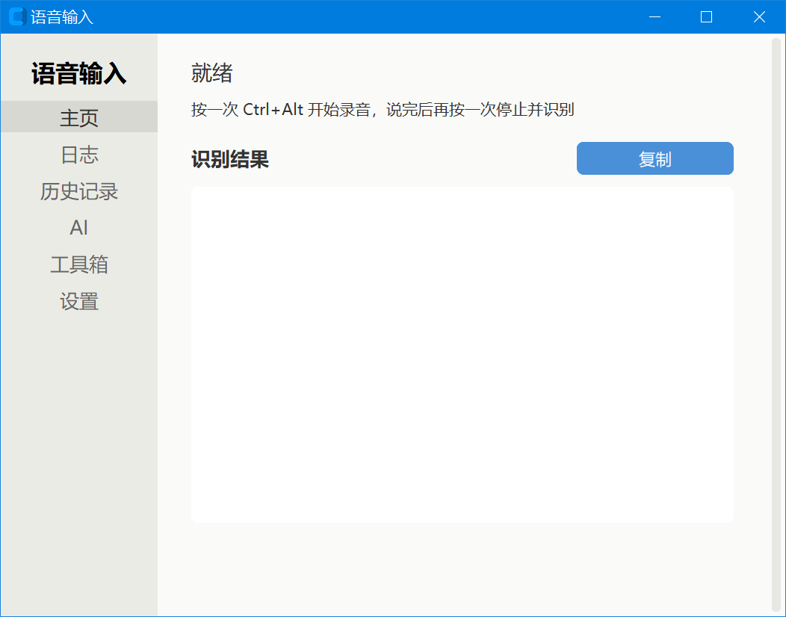
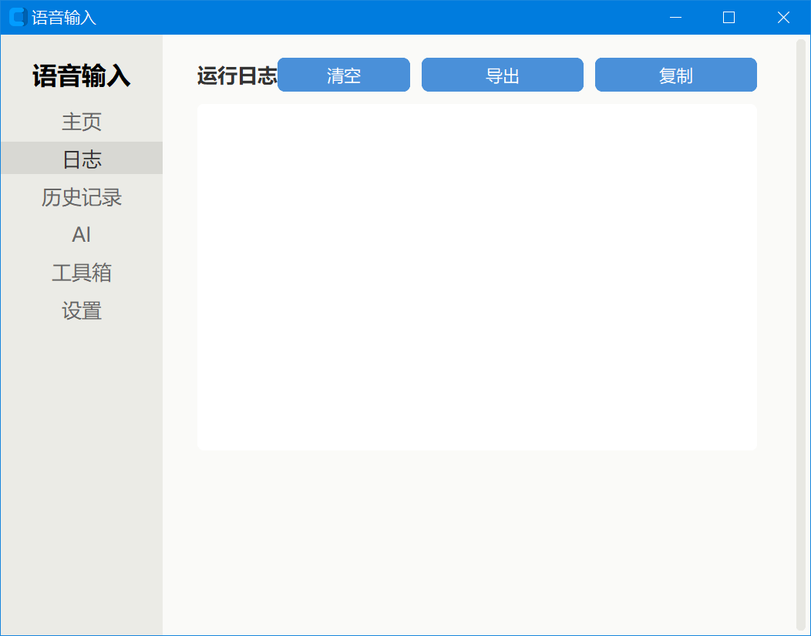
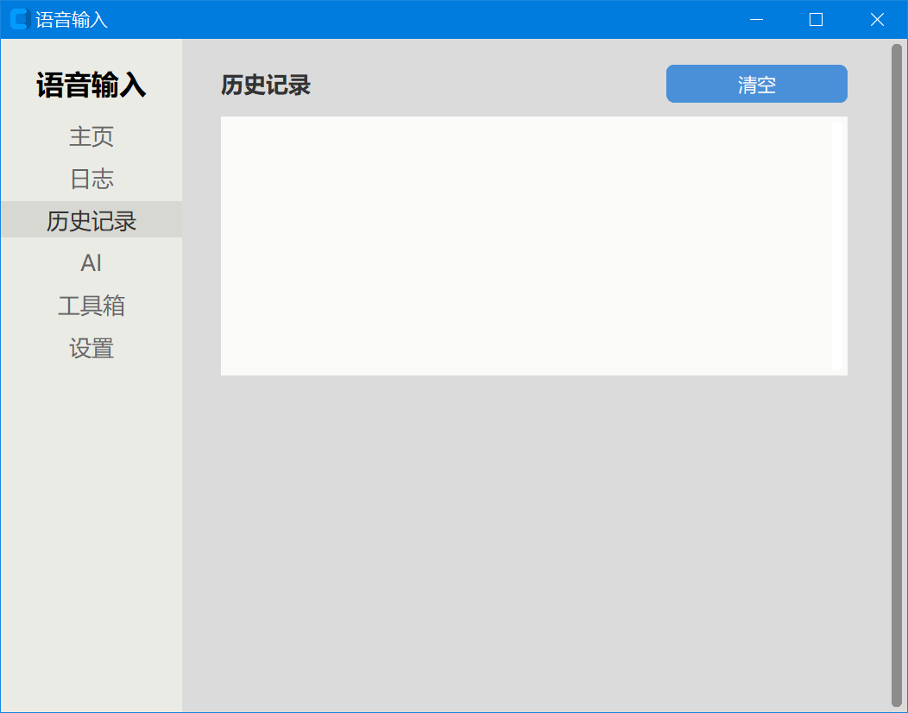
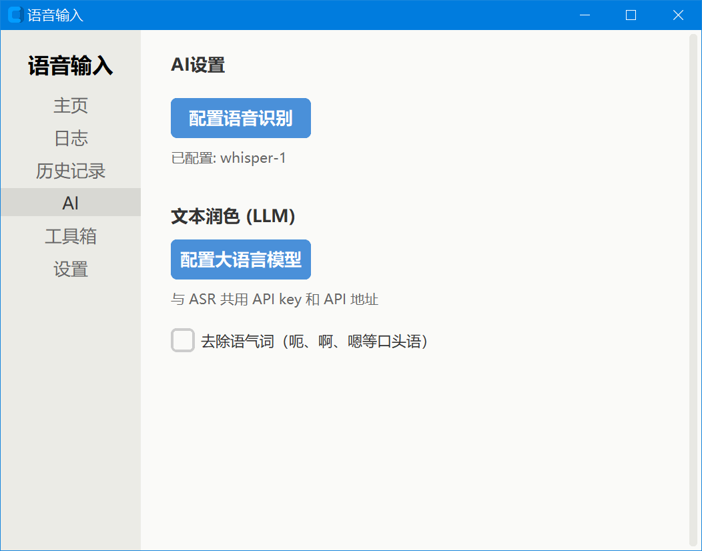
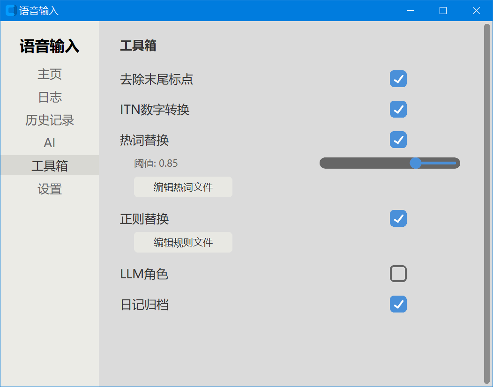
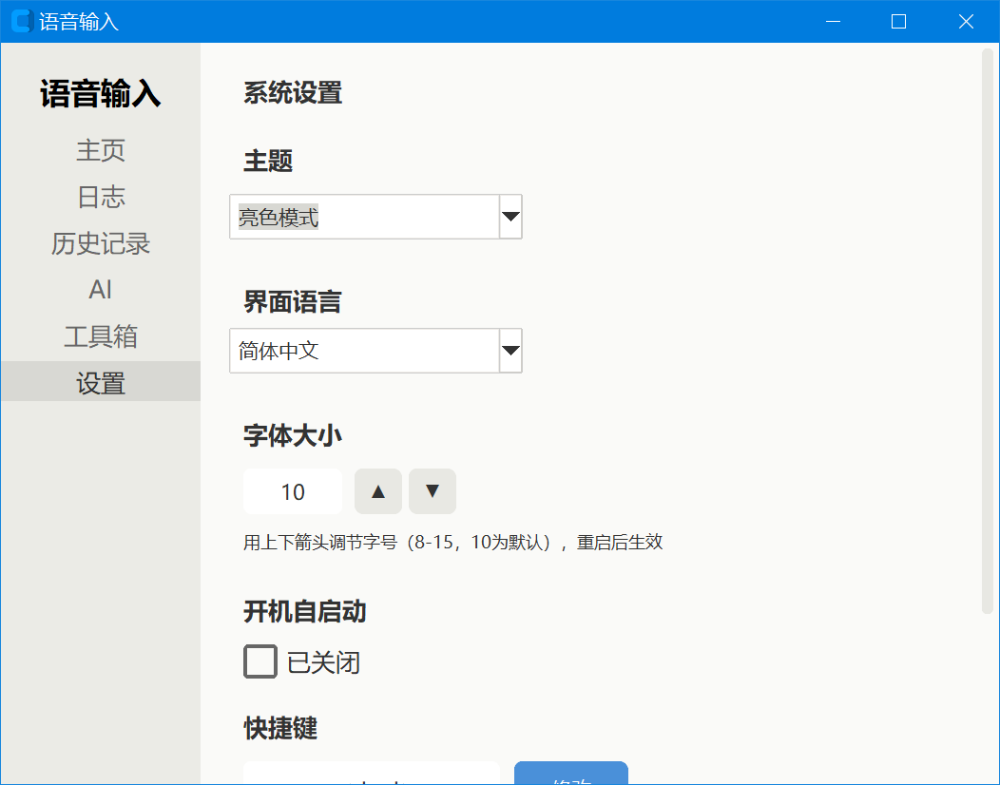
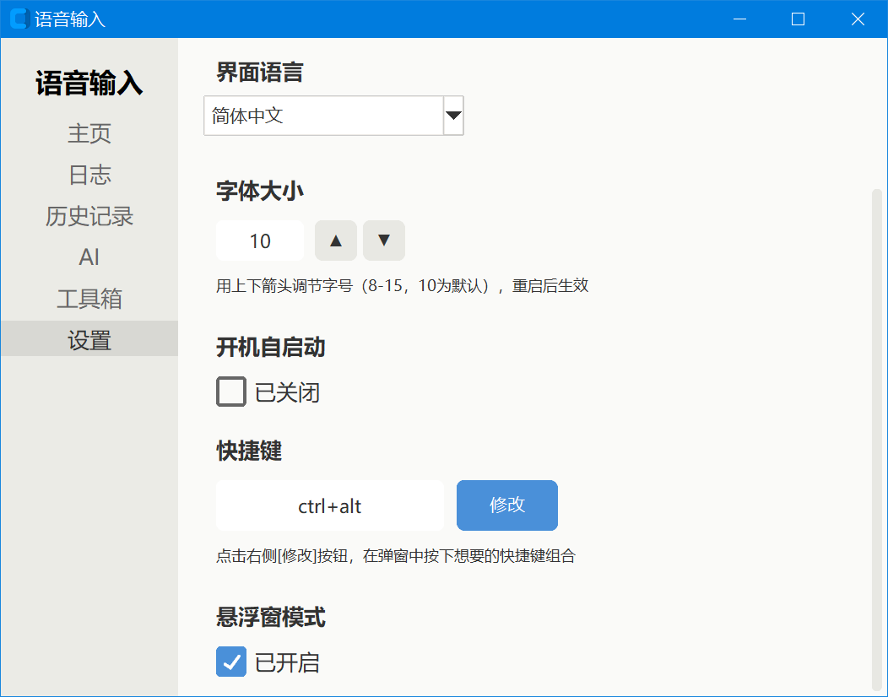

[中文](README_zh.md) | [English](README.md) | [日本語](README_ja.md) | [한국어](README_ko.md) | [Русский](README_ru.md) | [Español](README_es.md) | [Français](README_fr.md) | [Deutsch](README_de.md) | [Português](README_pt.md)

# Entrada por Voz - Manual de Utilização

## I. Introdução do Software

Este é um método de entrada por voz para a plataforma Windows, que se conecta a uma API ASR (reconhecimento de fala) de terceiros. Pressione a tecla de atalho para iniciar a gravação e pressione novamente para parar a gravação, inserindo automaticamente o texto reconhecido na posição atual do cursor.

## Pré-visualização da interface

**Início** — status de gravação e último resultado de reconhecimento

**Registro** — logs do programa em tempo real (gravação, reconhecimento, pós-processamento)

**Histórico** — navegar pelos resultados de reconhecimento anteriores

**Configuração de IA** — provedor ASR, chave API, nome do modelo

**Caixa de ferramentas** — interruptores centralizados de pós-processamento de texto

**Configurações (parte 1)** — atalho, tema, tamanho da fonte, idioma

**Configurações (parte 2)** — início automático, janela flutuante, etc.

## II. Funcionalidades Principais

- Voz para texto: a gravação é acionada por uma tecla de atalho global e o resultado do reconhecimento é colado automaticamente na posição do cursor
- Suporte a múltiplos provedores: suporta três serviços ASR no formato compatível com OpenAI, Doubao e Volcengine
- Janela flutuante: exibe o status em tempo real durante a gravação (com borda fina na cor do tema), o resultado é copiado automaticamente para a área de transferência e colado
- Histórico: salva automaticamente cada resultado de reconhecimento, com suporte a formato de recuo de parágrafo
- Interface multilíngue: 35 idiomas de interface integrados, com correspondência automática da fonte mais adequada
- Alternância de tema: suporta temas claro / escuro, com atualização unificada das cores de todos os controles
- Ajuste de tamanho de fonte: ajuste o nível do tamanho da fonte pelas setas para cima e para baixo (8 ~ 15, padrão 10), afetando apenas a fonte e não os controles
- Personalização da tecla de atalho: clique no botão "Modificar" e pressione a combinação de teclas na janela pop-up para capturar; suporta combinações de 1 ~ 3 teclas
- Substituição de palavras quentes: palavras raras são escritas na tabela de palavras quentes e substituídas forçadamente por correspondência fonética aproximada
- Substituição por regras de regex: substitui com precisão o texto especificado por equações ou regras de regex
- Conversão numérica ITN: converte automaticamente "十五六个" em "15~16个", com suporte a intervalos, datas, porcentagens, frações, etc.; palavras protegidas integradas para evitar conversão incorreta de "一会儿" e "一样"
- Remoção de muletas de fala: remove automaticamente muletas de fala como "呃、啊、嗯" (processamento puramente local, não depende de LLM)
- Processamento de papéis LLM: quando o resultado do reconhecimento começa com o nome de um papel, ele é processado pelo papel do grande modelo correspondente (refinamento, tradução, assistente, etc.); o arquivo de papel é analisado com segurança por AST, permitindo apenas atribuições literais
- Comandos de voz: ao dizer comandos como "撤销", "换行", "退格", a operação correspondente é executada automaticamente
- Arquivamento de diário: salva cada entrada de voz e resultado de reconhecimento por data
- Inicialização automática: inicialização automática opcional ao ligar o computador
- Bandeja do sistema: minimiza para a bandeja, botão esquerdo abre a janela principal, botão direito sai

## III. Início Rápido

1. Após iniciar o programa, ele é minimizado por padrão para a bandeja do sistema
2. Clique com o botão esquerdo no ícone da bandeja para abrir a janela principal
3. Antes do primeiro uso, acesse a página "Configuração de IA" para preencher o provedor ASR e a chave da API
4. Em qualquer janela que aceite entrada de texto, posicione o cursor onde deseja inserir o texto
5. Pressione `Ctrl+Alt` para iniciar a gravação (o ícone da bandeja fica vermelho, a janela flutuante aparece)
6. Fale no microfone
7. Pressione `Ctrl+Alt` novamente para parar a gravação
8. O resultado do reconhecimento será colado automaticamente na posição do cursor

> Dica: se você pressionar a tecla de atalho para gravar sem ter configurado a API, a janela flutuante exibirá "IA não configurada"; conclua a configuração primeiro.

## IV. Descrição da Interface

O lado esquerdo da janela principal é a barra de navegação, contendo as seguintes páginas:

- Página inicial: exibe o status da gravação e o resultado do último reconhecimento, com botão de copiar
- Log: exibe em tempo real o log de execução do programa, incluindo informações de cada fase de gravação, reconhecimento e pós-processamento
- Histórico: navega pelos registros de reconhecimento histórico, com suporte a cópia e exibição com recuo de parágrafo
- Configuração de IA: preencha o provedor ASR, o endereço e a chave da API, o nome do modelo, etc.; inclui os interruptores "Ativar refinamento de texto" e "Ativar papéis LLM"
- Caixa de ferramentas: reúne os interruptores das várias funções de pós-processamento de texto (remover pontuação final, ITN, remover muletas de fala, palavras quentes, regras de regex, arquivamento de diário)
- Configurações: configurações gerais, incluindo tecla de atalho, tema, tamanho da fonte, idioma da interface, inicialização automática, janela flutuante, etc.

## V. Detalhes das Configurações

### Relacionado ao ASR (Página de Configuração de IA)

| Item de configuração | Função |
| --- | --- |
| Provedor ASR | Seleciona o serviço de reconhecimento de fala: openai_compatible (compatível com OpenAI), doubao, volcengine |
| base_url | Endereço base da API compatível com OpenAI |
| api_key | Chave da API compatível com OpenAI |
| model | Nome do modelo, como whisper-1 |
| app_key | Chave do aplicativo Doubao / Volcengine |
| access_key | Chave de acesso Doubao / Volcengine |
| resource_id | ID do recurso Doubao |
| cluster | Nome do cluster Volcengine |
| asr_mode | Modo de reconhecimento ASR |
| Ativar refinamento de texto | Interruptor principal; quando desativado, não chama o LLM |
| Ativar papéis LLM | Opcional apenas quando o refinamento de texto está ativado; fica esmaecido quando desativado |

### Configurações Gerais (Página de Configurações)

| Item de configuração | Função |
| --- | --- |
| Tecla de atalho | Tecla de atalho global que aciona a gravação, padrão Ctrl+Alt; clique em "Modificar" para capturar uma nova combinação na janela pop-up |
| Tema | Claro (light) ou escuro (dark), padrão escuro |
| Tamanho da fonte | Nível do tamanho da fonte 8 ~ 15, padrão 10; ajuste pelas setas para cima e para baixo, afeta apenas a fonte e não os controles, entra em vigor após reiniciar |
| Idioma da interface | Alterna o idioma exibido na interface, com 35 opções disponíveis |
| Inicialização automática | Quando ativado, o programa inicia automaticamente ao ligar o computador |
| Janela flutuante | Quando ativado, exibe a janela flutuante durante a gravação (com borda fina na cor do tema); quando desativado, o resultado é exibido apenas na caixa de texto da janela principal |

### Interruptores de Pós-processamento de Texto (Página da Caixa de Ferramentas)

| Item de configuração | Função | Padrão |
| --- | --- | --- |
| Remover vírgulas e pontos finais | Remove automaticamente vírgulas e pontos finais do final do resultado do reconhecimento | Ligado |
| Conversão numérica ITN | Converte "十五六个" em formatos numéricos como "15~16个"; palavras protegidas integradas para evitar conversão incorreta de "一会儿" e "一样" | Ligado |
| Remover muletas de fala | Remove automaticamente muletas de fala como "呃、啊、嗯" (processamento puramente local, não depende de LLM) | Ligado |
| Substituição de palavras quentes | Substitui forçadamente palavras raras por correspondência fonética aproximada | Ligado |
| Limite de correspondência de palavras quentes | Limite de similaridade de palavras quentes, 0.0~1.0, quanto maior, mais rigoroso | 0.85 |
| Substituição por regras de regex | Substitui com precisão o texto por equações ou regras de regex | Ligado |
| Arquivamento de diário | Salva cada entrada de voz e resultado de reconhecimento por data | Ligado |

> Os interruptores relacionados ao LLM (Ativar refinamento de texto, Ativar papéis LLM) estão localizados na página "Configuração de IA", não na caixa de ferramentas.

### Parâmetros de Áudio

| Item de configuração | Função | Padrão |
| --- | --- | --- |
| sample_rate | Taxa de amostragem de áudio (Hz) | 16000 |
| chunk_size | Tamanho do bloco de áudio (bytes) | 3200 |

## VI. Idiomas de Interface Suportados

O software integra os seguintes 35 idiomas de interface, cada idioma é automaticamente correspondido à fonte mais adequada (chinês usa Microsoft YaHei, japonês usa Yu Gothic, coreano usa Malgun Gothic, outros idiomas usam Segoe UI):

1. Chinês Simplificado (zh_CN)
2. Chinês Tradicional (zh_TW)
3. Inglês (en)
4. Espanhol (es)
5. Árabe (ar)
6. Hindi (hi)
7. Indonésio (id)
8. Japonês (ja)
9. Francês (fr)
10. Alemão (de)
11. Russo (ru)
12. Português (pt)
13. Italiano (it)
14. Turco (tr)
15. Polonês (pl)
16. Holandês (nl)
17. Coreano (ko)
18. Vietnamita (vi)
19. Bengali (bn)
20. Urdu (ur)
21. Filipino (fil)
22. Malaio (ms)
23. Tailandês (th)
24. Tcheco (cs)
25. Húngaro (hu)
26. Sueco (sv)
27. Finlandês (fi)
28. Romeno (ro)
29. Ucraniano (uk)
30. Grego (el)
31. Dinamarquês (da)
32. Norueguês (no)
33. Hebraico (he)
34. Búlgaro (bg)
35. Croata (hr)

Na primeira inicialização, o idioma da interface é selecionado automaticamente com base no idioma do sistema; posteriormente, pode ser alternado manualmente na página "Configurações".

## VII. Perguntas Frequentes

### 1. A tecla de atalho não responde?

- Confirme se o software está em execução na bandeja do sistema (ícone cinza na bandeja indica pronto)
- Confirme se a tecla de atalho não está sendo usada por outro software
- Acesse a página "Configurações", clique no botão "Modificar" ao lado da tecla de atalho e pressione a combinação de teclas novamente na janela pop-up
- Verifique se há mensagens de erro na página de log

### 2. O que fazer quando o reconhecimento falha?

- Verifique se a chave da API, o endereço e o modelo preenchidos na página "Configuração de IA" estão corretos
- Verifique se a conexão de rede está normal
- Abra a página "Log" para ver as mensagens de erro específicas
- Confirme se o microfone está funcionando corretamente e se o volume da fala é suficiente

### 3. Como ajustar o tamanho da fonte?

Acesse a página "Configurações", encontre o item "Tamanho da fonte" e ajuste o nível usando as setas para cima e para baixo à direita (8 ~ 15, padrão 10). Quanto maior o valor, maior a fonte. Esta configuração afeta apenas a fonte e não altera o tamanho dos controles, como botões; é necessário reiniciar o programa para que a alteração entre em vigor.

### 4. Como personalizar a tecla de atalho?

Acesse a página "Configurações", encontre o item "Tecla de atalho", clique no botão "Modificar" à direita e, na janela independente pop-up, pressione a combinação de teclas desejada (suporta 1 ~ 3 teclas, como Ctrl+Shift+V). Após a captura, clique em "Confirmar" para salvar; a nova tecla de atalho entra em vigor após reiniciar o programa.

### 5. O resultado do reconhecimento não é colado automaticamente?

- Confirme se a janela de destino suporta a operação de colar
- Confirme se o cursor está posicionado em uma área de entrada
- Se a janela flutuante estiver desativada, o resultado do reconhecimento será exibido apenas na caixa de texto da janela principal, sendo necessário clicar manualmente no botão de copiar

### 6. Como adicionar palavras raras para melhorar a precisão do reconhecimento?

Edite diretamente o arquivo `config/hot.txt`, uma palavra quente por linha. Ao mesmo tempo, você pode usar equações ou regras de regex no arquivo `config/hot-rule.txt` para substituições precisas.

### 7. Como usar os papéis LLM?

Crie um arquivo `.py` no diretório `config/roles/` e, dentro do arquivo, defina os atributos do papel por atribuição de variáveis (name, trigger_words, system_prompt, output_mode, etc.). O arquivo de papel é analisado com segurança por AST, permitindo apenas atribuições literais; não é permitido escrever chamadas de função ou código arbitrário. Quando o resultado do reconhecimento começa com o nome de um papel, o papel correspondente é acionado automaticamente.
