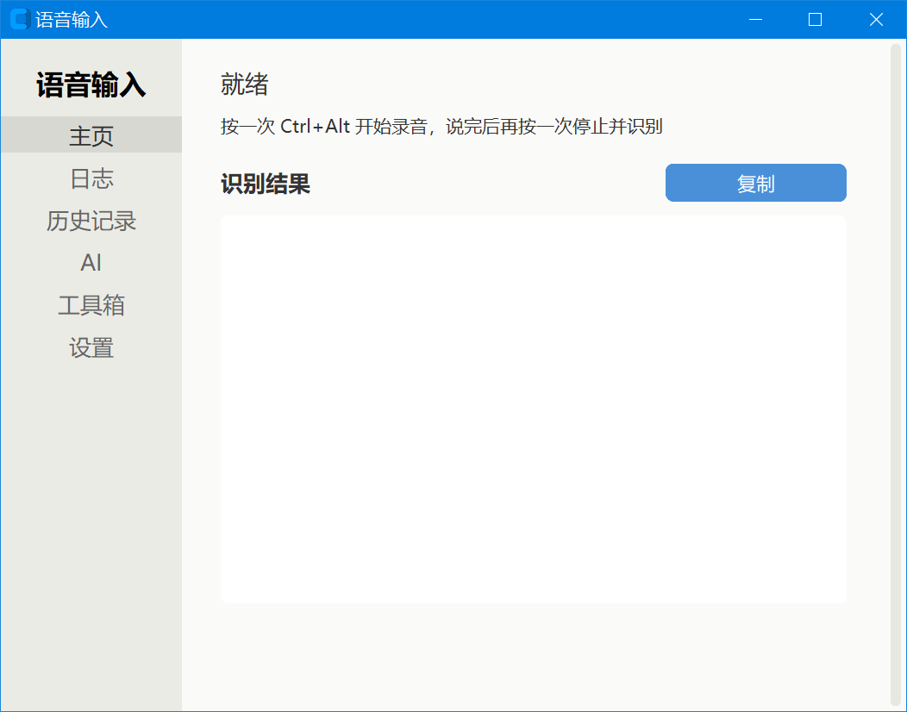
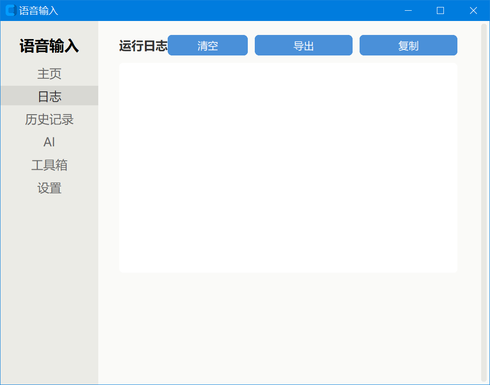
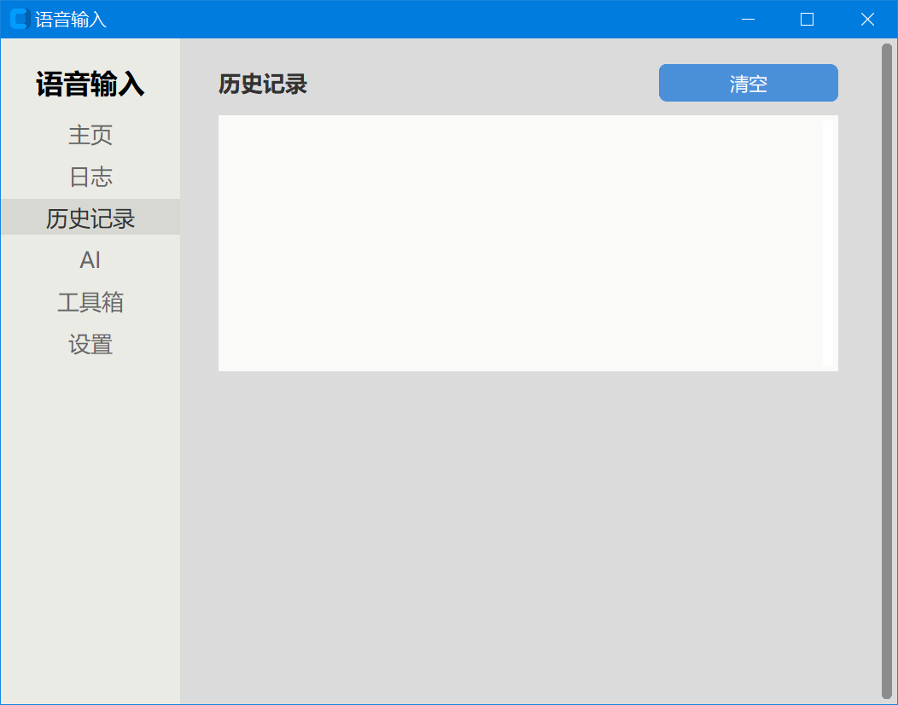
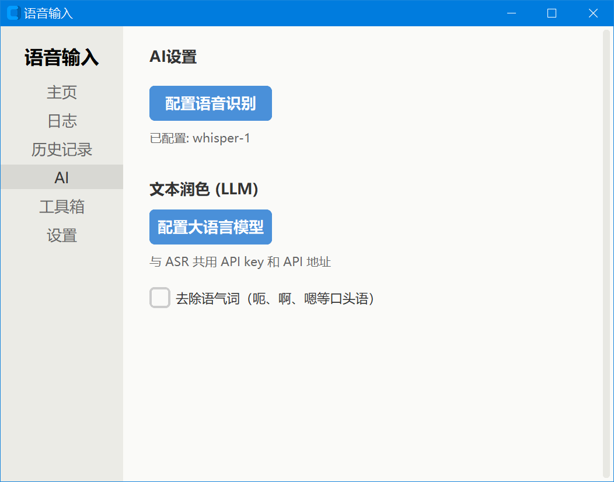
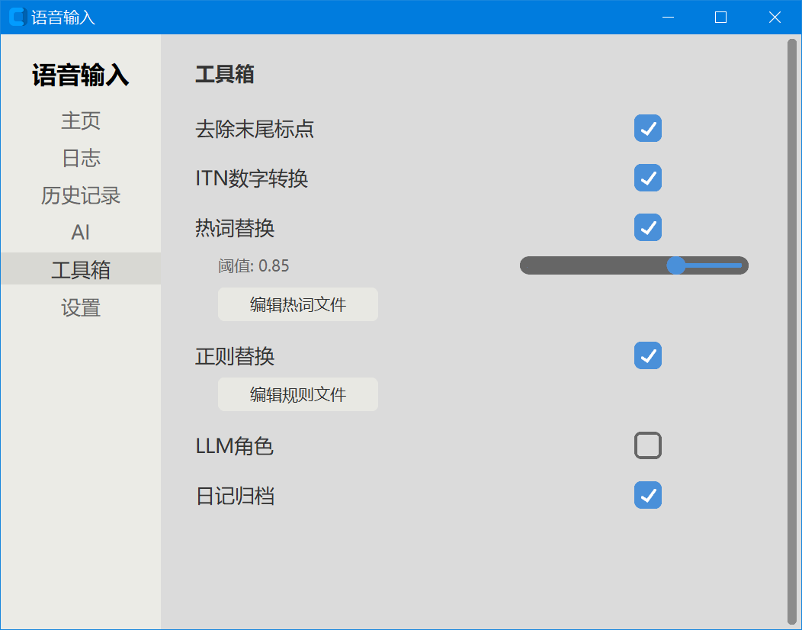
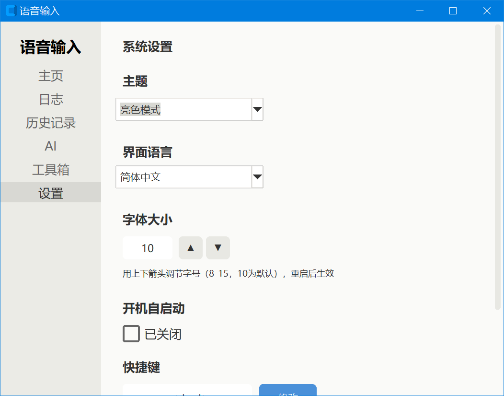
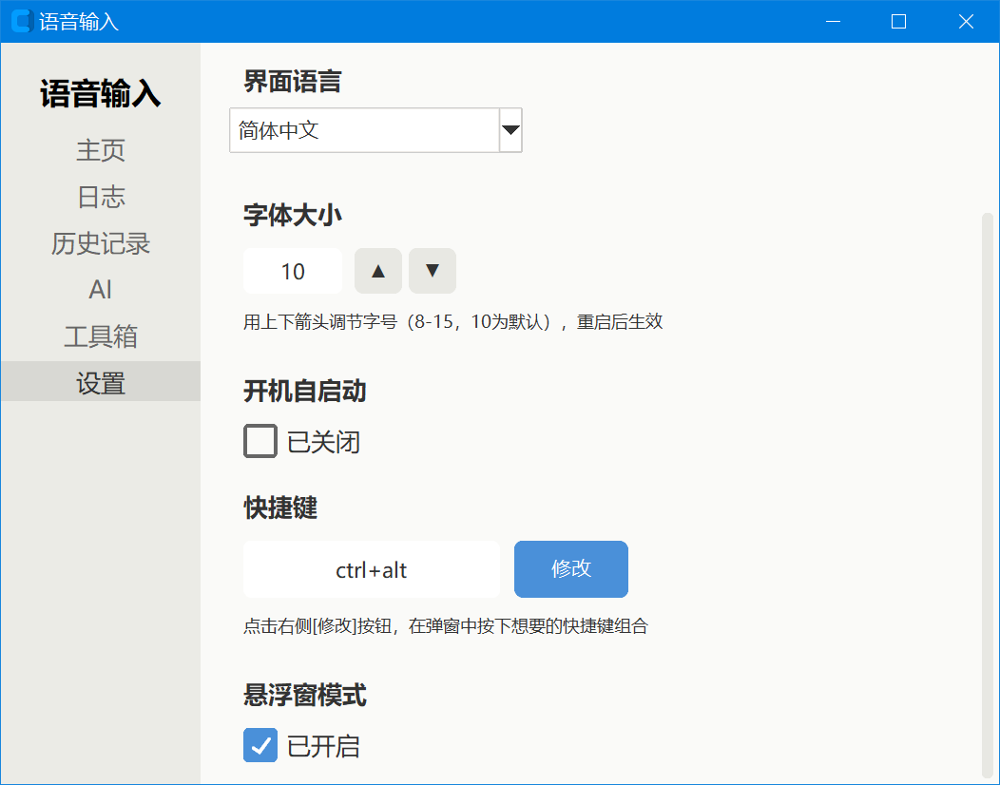

[中文](README_zh.md) | [English](README.md) | [日本語](README_ja.md) | [한국어](README_ko.md) | [Русский](README_ru.md) | [Español](README_es.md) | [Français](README_fr.md) | [Deutsch](README_de.md) | [Português](README_pt.md)

# Инструкция по использованию голосового ввода

## I. Введение

Это метод голосового ввода для платформы Windows, использующий сторонний ASR (распознавание речи) API. Нажмите горячую клавишу для начала записи, нажмите ещё раз для остановки записи и автоматического ввода распознанного текста в текущую позицию курсора.

## Предпросмотр интерфейса

**Главная** — статус записи и последний результат распознавания

**Журнал** — журналы программы в реальном времени (запись, распознавание, постобработка)

**История** — просмотр предыдущих результатов распознавания

**Настройка ИИ** — провайдер ASR, ключ API, название модели

**Инструменты** — переключатели постобработки текста

**Настройки (часть 1)** — горячая клавиша, тема, размер шрифта, язык

**Настройки (часть 2)** — автозапуск, плавающее окно и т.д.

## II. Основные функции

- Преобразование голоса в текст: запись запускается глобальной горячей клавишей, результат распознавания автоматически вставляется в позицию курсора
- Поддержка нескольких провайдеров: поддержка трёх служб ASR — OpenAI-совместимый формат, модель Doubao, Volcengine
- Плавающее окно: отображение статуса записи в реальном времени (с тонкой рамкой цвета темы), результат автоматически копируется в буфер обмена и вставляется
- История: автоматическое сохранение каждого результата распознавания, поддержка форматирования с отступами абзацев
- Многоязычный интерфейс: встроенная поддержка 35 языков интерфейса, автоматический подбор наиболее подходящего шрифта
- Переключение темы: поддержка светлой / тёмной тем, единое обновление цветов всех элементов управления
- Регулировка размера шрифта: настройка уровня размера шрифта с помощью стрелок вверх/вниз (8 ~ 15, по умолчанию 10), влияет только на шрифт, а не на элементы управления
- Настройка горячих клавиш: нажмите кнопку «Изменить» и в всплывающем окне нажмите комбинацию клавиш для захвата, поддерживаются комбинации из 1 ~ 3 клавиш
- Замена горячих слов: запишите редкие слова в таблицу горячих слов, принудительная замена по нечёткому фонетическому совпадению
- Замена по правилам регулярных выражений: точная замена указанного текста с помощью уравнений или правил регулярных выражений
- ITN-преобразование чисел: автоматическое преобразование «十五六个» в «15~16个», поддержка диапазонов, дат, процентов, дробей и т. д.; встроенные защитные слова предотвращают ошибочное преобразование «一会儿» «一样»
- Удаление слов-паразитов: автоматическое удаление устных слов-паразитов «呃, 啊, 嗯» и т. д. (не зависит от LLM, чисто локальная обработка)
- Обработка ролей LLM: когда результат распознавания начинается с имени роли, обработка передаётся соответствующей роли большой модели (редактура, перевод, ассистент и т. д.); файлы ролей безопасно анализируются через AST, допускается только присваивание литералов
- Голосовые команды: произнесите команды «撤销» «换行» «退格» и т. д. для автоматического выполнения соответствующих действий
- Архивация дневника: сохранение каждой голосовой фразы и результата распознавания по датам
- Автозапуск при загрузке: опциональный автоматический запуск при загрузке системы
- Системный трей: сворачивание в трей, левый клик открывает главное окно, правый клик — выход

## III. Быстрый старт

1. После запуска программа по умолчанию сворачивается в системный трей
2. Левый клик по значку в трее открывает главное окно
3. Перед первым использованием перейдите на страницу «Настройка AI» и заполните провайдера ASR и API-ключ
4. В любом окне, поддерживающем ввод текста, поместите курсор в позицию ввода
5. Нажмите `Ctrl+Alt` для начала записи (значок в трее станет красным, появится плавающее окно)
6. Говорите в микрофон
7. Снова нажмите `Ctrl+Alt` для остановки записи
8. Результат распознавания будет автоматически вставлен в позицию курсора

> Подсказка: если нажать горячую клавишу записи без настройки API, в плавающем окне появится сообщение «AI не настроен», сначала завершите настройку.

## IV. Описание интерфейса

В левой части главного окна находится панель навигации, содержащая следующие страницы:

- Главная: отображение статуса записи и последнего результата распознавания, кнопка копирования
- Журнал: отображение журнала работы программы в реальном времени, включая информацию о этапах записи, распознавания и постобработки
- История: просмотр исторических записей распознавания, поддержка копирования и отображения с отступами абзацев
- Настройка AI: заполнение провайдера ASR, адреса API и ключа, названия модели и т. д.; содержит переключатели «Включить редактуру текста» и «Включить роли LLM»
- Инструменты: централизованное управление переключателями функций постобработки текста (удаление конечной пунктуации, ITN, удаление слов-паразитов, горячие слова, правила регулярных выражений, архивация дневника)
- Настройки: общие настройки, включая горячие клавиши, тему, размер шрифта, язык интерфейса, автозапуск, плавающее окно и т. д.

## V. Подробное описание настроек

### ASR (страница «Настройка AI»)

| Параметр | Назначение |
| --- | --- |
| Провайдер ASR | Выбор службы распознавания речи: openai_compatible (OpenAI-совместимый), doubao, volcengine |
| base_url | Базовый адрес OpenAI-совместимого API |
| api_key | Ключ OpenAI-совместимого API |
| model | Название модели, например whisper-1 |
| app_key | Ключ приложения Doubao / Volcengine |
| access_key | Ключ доступа Doubao / Volcengine |
| resource_id | Идентификатор ресурса Doubao |
| cluster | Имя кластера Volcengine |
| asr_mode | Режим распознавания ASR |
| Включить редактуру текста | Общий переключатель; при отключении LLM не вызывается |
| Включить роли LLM | Доступно только при включённой редактуре текста; отображается серым при отключении |

### Общие настройки (страница «Настройки»)

| Параметр | Назначение |
| --- | --- |
| Горячая клавиша | Глобальная горячая клавиша для запуска записи, по умолчанию Ctrl+Alt; нажмите «Изменить» для захвата новой комбинации в всплывающем окне |
| Тема | Светлая (light) или тёмная (dark), по умолчанию тёмная |
| Размер шрифта | Уровень размера шрифта 8 ~ 15, по умолчанию 10; настройка стрелками вверх/вниз, влияет только на шрифт, а не на элементы управления; вступает в силу после перезапуска |
| Язык интерфейса | Переключение языка интерфейса, всего доступно 35 языков |
| Автозапуск при загрузке | При включении программа автоматически запускается при загрузке системы |
| Плавающее окно | При включении во время записи отображается плавающее окно (с тонкой рамкой цвета темы); при отключении результат отображается только в текстовом поле главного окна |

### Переключатели постобработки текста (страница «Инструменты»)

| Параметр | Назначение | По умолчанию |
| --- | --- | --- |
| Удаление конечной пунктуации | Автоматическое удаление запятых и точек в конце результата распознавания | Вкл |
| ITN-преобразование чисел | Преобразование «十五六个» в «15~16个» и другие числовые форматы; встроенные защитные слова предотвращают ошибочное преобразование «一会儿» «一样» | Вкл |
| Удаление слов-паразитов | Автоматическое удаление устных слов-паразитов «呃, 啊, 嗯» и т. д. (чисто локальная обработка, не зависит от LLM) | Вкл |
| Замена горячих слов | Принудительная замена редких слов по нечёткому фонетическому совпадению | Вкл |
| Порог совпадения горячих слов | Порог сходства горячих слов, 0.0~1.0, чем выше, тем строже | 0.85 |
| Замена по правилам регулярных выражений | Точная замена текста по уравнениям или правилам регулярных выражений | Вкл |
| Архивация дневника | Сохранение каждой голосовой фразы и результата распознавания по датам | Вкл |

> Переключатели, связанные с LLM (включение редактуры текста, включение ролей LLM), находятся на странице «Настройка AI», а не в «Инструментах».

### Параметры аудио

| Параметр | Назначение | По умолчанию |
| --- | --- | --- |
| sample_rate | Частота дискретизации аудио (Гц) | 16000 |
| chunk_size | Размер аудиоблока (байты) | 3200 |

## VI. Поддерживаемые языки интерфейса

Программа содержит следующие 35 языков интерфейса, для каждого языка автоматически подбирается наиболее подходящий шрифт (китайский — Microsoft YaHei, японский — Yu Gothic, корейский — Malgun Gothic, другие языки — Segoe UI):

1. Упрощённый китайский (zh_CN)
2. Традиционный китайский (zh_TW)
3. Английский (en)
4. Испанский (es)
5. Арабский (ar)
6. Хинди (hi)
7. Индонезийский (id)
8. Японский (ja)
9. Французский (fr)
10. Немецкий (de)
11. Русский (ru)
12. Португальский (pt)
13. Итальянский (it)
14. Турецкий (tr)
15. Польский (pl)
16. Нидерландский (nl)
17. Корейский (ko)
18. Вьетнамский (vi)
19. Бенгальский (bn)
20. Урду (ur)
21. Филиппинский (fil)
22. Малайский (ms)
23. Тайский (th)
24. Чешский (cs)
25. Венгерский (hu)
26. Шведский (sv)
27. Финский (fi)
28. Румынский (ro)
29. Украинский (uk)
30. Греческий (el)
31. Датский (da)
32. Норвежский (no)
33. Иврит (he)
34. Болгарский (bg)
35. Хорватский (hr)

При первом запуске язык интерфейса выбирается автоматически на основе языка системы, после чего его можно переключить вручную на странице «Настройки».

## VII. Часто задаваемые вопросы

### 1. Горячая клавиша не реагирует?

- Убедитесь, что программа запущена в системном трее (серый значок в трее означает готовность)
- Убедитесь, что горячая клавиша не занята другим ПО
- Перейдите на страницу «Настройки», нажмите кнопку «Изменить» рядом с горячей клавишей и в всплывающем окне снова нажмите комбинацию клавиш
- Проверьте, есть ли сообщения об ошибках на странице журнала

### 2. Что делать при неудачном распознавании?

- Проверьте правильность API-ключа, адреса и модели на странице «Настройка AI»
- Проверьте сетевое подключение
- Откройте страницу «Журнал» для просмотра подробной информации об ошибках
- Убедитесь, что микрофон работает нормально и громкость речи достаточна

### 3. Как изменить размер шрифта?

Перейдите на страницу «Настройки», найдите параметр «Размер шрифта» и настройте уровень с помощью стрелок вверх/вниз справа (8 ~ 15, по умолчанию 10). Чем выше значение, тем больше шрифт. Этот параметр влияет только на шрифт и не изменяет размер кнопок и других элементов управления; после настройки требуется перезапуск программы для вступления в силу.

### 4. Как настроить горячую клавишу?

Перейдите на страницу «Настройки», найдите параметр «Горячая клавиша», нажмите кнопку «Изменить» справа и в открывшемся отдельном окне нажмите желаемую комбинацию клавиш (поддерживаются 1 ~ 3 клавиши, например Ctrl+Shift+V). После захвата нажмите «Подтвердить» для сохранения; новая горячая клавиша вступит в силу после перезапуска программы.

### 5. Результат распознавания не вставляется автоматически?

- Убедитесь, что целевое окно поддерживает операцию вставки
- Убедитесь, что курсор находится в области ввода
- Если плавающее окно отключено, результат распознавания отображается только в текстовом поле главного окна; для копирования нужно нажать кнопку вручную

### 6. Как добавить редкие слова для повышения точности распознавания?

Напрямую отредактируйте файл `config/hot.txt`, по одному горячему слову в строке. Также в файле `config/hot-rule.txt` можно использовать уравнения или правила регулярных выражений для точной замены.

### 7. Как использовать роли LLM?

Создайте файл `.py` в каталоге `config/roles/`; внутри файла определите атрибуты роли через присваивание переменных (name, trigger_words, system_prompt, output_mode и т. д.). Файлы ролей безопасно анализируются через AST, допускается только присваивание литералов — нельзя писать вызовы функций или произвольный код. Когда результат распознавания начинается с имени роли, соответствующая роль запускается автоматически.
