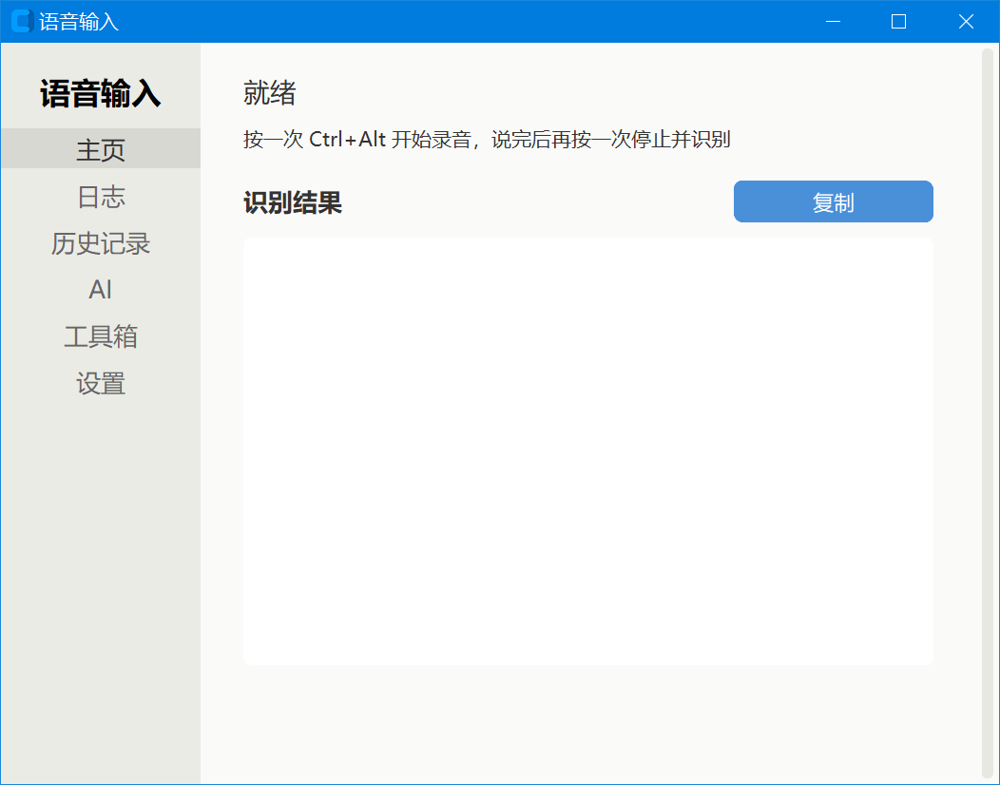
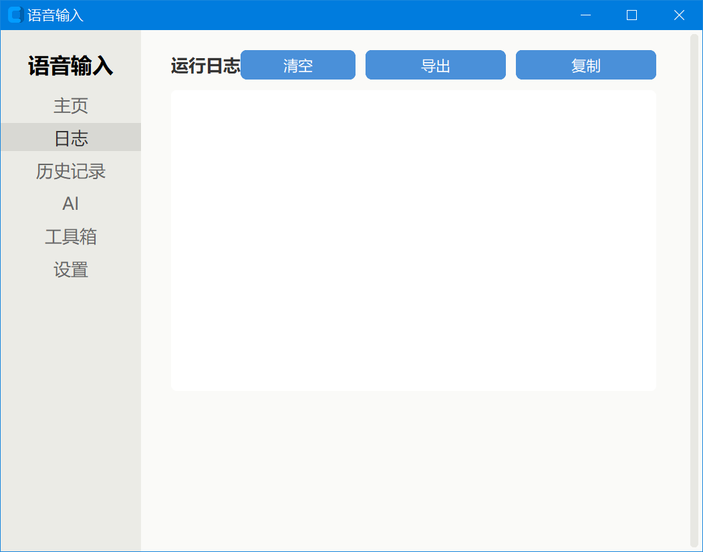
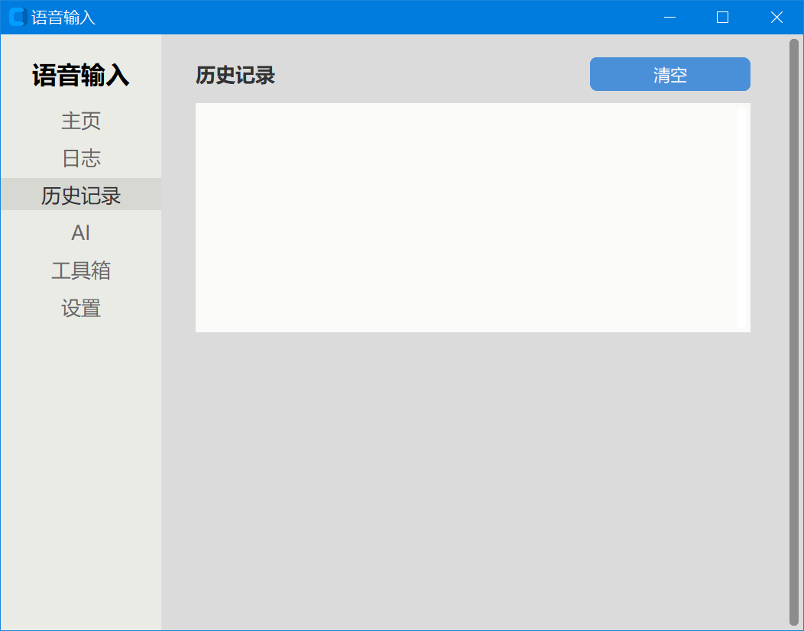
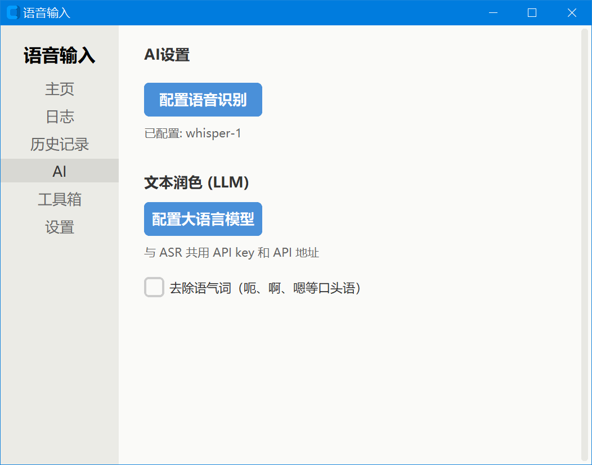
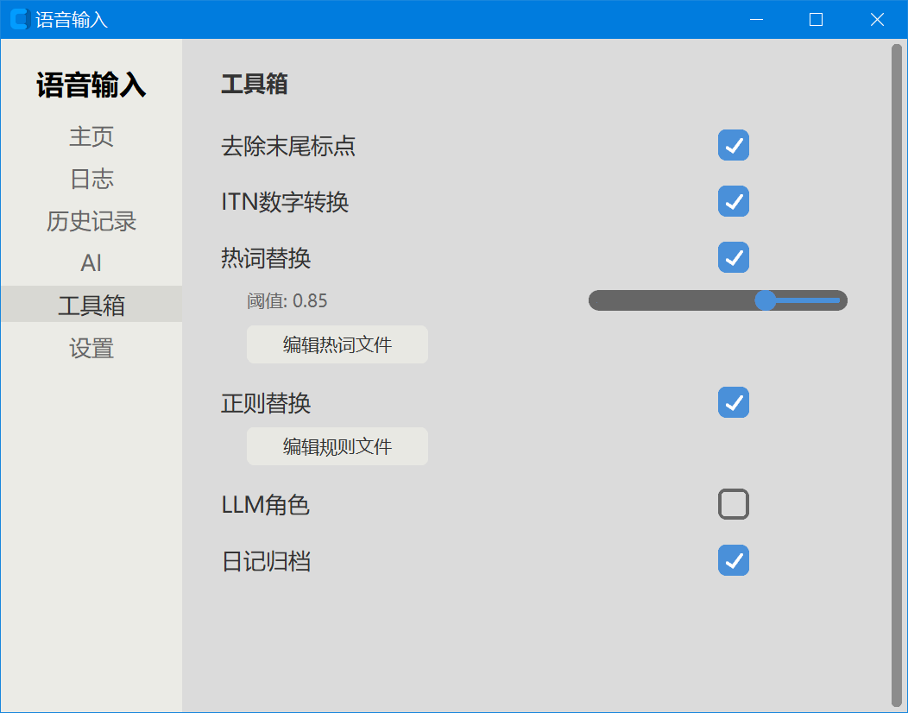
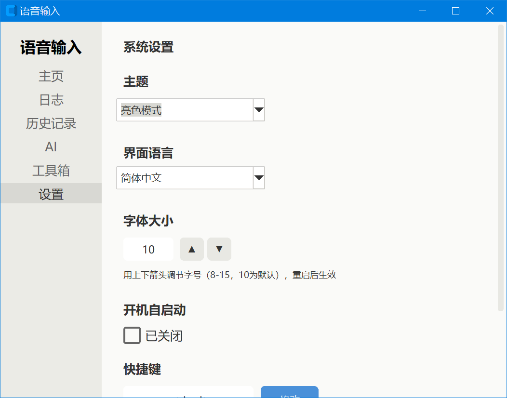
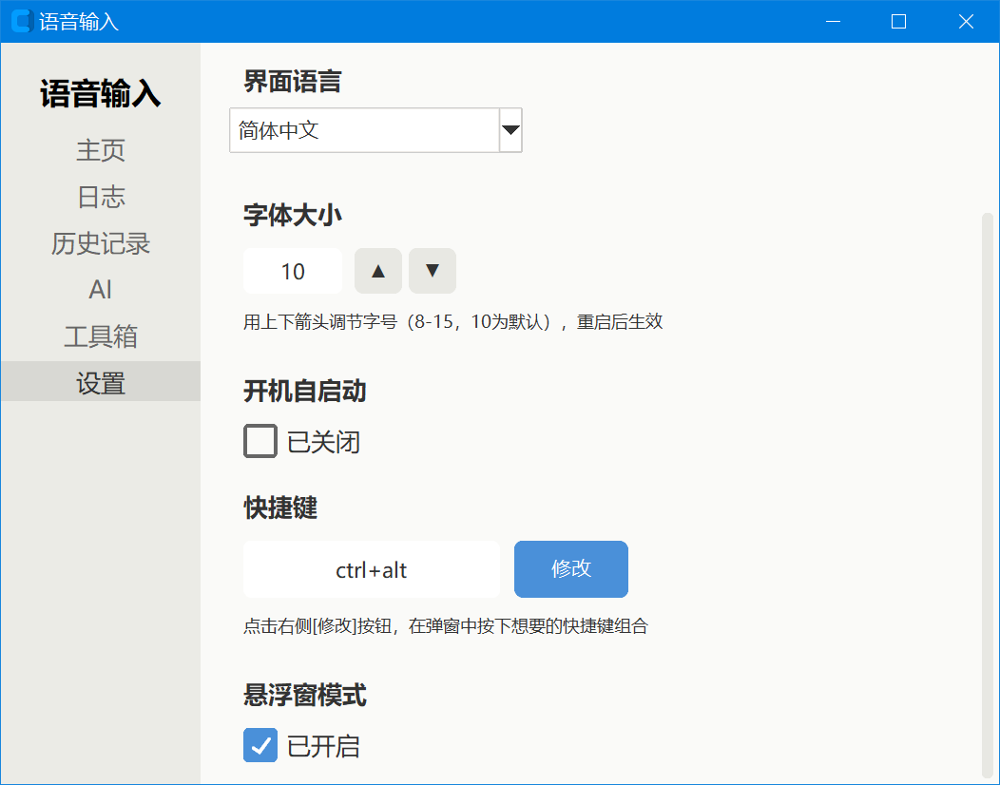

[中文](README_zh.md) | [English](README.md) | [日本語](README_ja.md) | [한국어](README_ko.md) | [Русский](README_ru.md) | [Español](README_es.md) | [Français](README_fr.md) | [Deutsch](README_de.md) | [Português](README_pt.md)

# 语音输入 使用说明

## 一、软件简介

这是一款 Windows 平台的语音输入法，接入第三方 ASR（语音识别）API，按下热键开始录音，再次按下热键即停止录音并将识别出的文字自动输入到当前光标位置。

## 界面预览

**主页** — 录音状态与最近一次识别结果

**日志** — 实时程序运行日志（录音、识别、后处理各阶段）

**历史记录** — 浏览历次识别记录

**AI 配置** — ASR 服务商、API 密钥、模型名称

**工具箱** — 文本后处理开关集中页

**设置（上半）** — 热键、主题、字号、界面语言

**设置（下半）** — 开机自启、悬浮窗等

## 二、核心功能

- 语音转文字：通过全局热键触发录音，识别结果自动粘贴到光标位置
- 多服务商支持：支持 OpenAI 兼容格式、豆包大模型、火山引擎三种 ASR 服务
- 悬浮窗：录音时显示实时状态（带主题色细边框），结果自动复制到剪贴板并粘贴
- 历史记录：自动保存每次识别结果，支持段落缩进格式
- 多语言界面：内置 35 种界面语言，自动匹配最合适的字体
- 主题切换：支持明亮 / 暗色两种主题，所有控件颜色统一刷新
- 字号调节：通过上下箭头调节字号等级（8 ~ 15，默认 10），仅影响字体不影响控件
- 热键自定义：点击"修改"按钮在弹窗中按下组合键捕获，支持 1 ~ 3 键组合
- 热词替换：将生僻词写入热词表，按音素模糊匹配强制替换
- 正则规则替换：通过等式或正则规则精确替换指定文字
- ITN 数字转换：把"十五六个"自动转成"15~16个"，支持范围、日期、百分比、分数等；内置保护词避免"一会儿""一样"误转
- 去除语气词：自动清除"呃、啊、嗯"等口头语气词（不依赖 LLM，纯本地处理）
- LLM 角色处理：识别结果以角色名开头时，交由对应大模型角色处理（润色、翻译、小助理等）；角色文件用 AST 安全解析，只允许字面量赋值
- 语音指令：说出"撤销""换行""退格"等命令，自动执行对应操作
- 日记归档：按日期保存每次语音输入及识别结果
- 开机自启：可选开机自动启动
- 系统托盘：最小化到托盘，左键打开主窗口，右键退出

## 三、快速上手

1. 启动程序后，软件默认最小化到系统托盘
2. 左键单击托盘图标打开主窗口
3. 第一次使用前，进入"AI 配置"页面填写 ASR 服务商与 API 密钥
4. 在任意能输入文字的窗口中，将光标放在要输入的位置
5. 按下 `Ctrl+Alt` 开始录音（托盘图标变红，悬浮窗出现）
6. 对着麦克风说话
7. 再次按下 `Ctrl+Alt` 停止录音
8. 识别结果会自动粘贴到光标位置

> 提示：如果未配置 API 就按热键录音，悬浮窗会提示"AI 未配置"，请先完成配置。

## 四、界面说明

主窗口左侧为导航栏，包含以下页面：

- 主页：显示录音状态与最近一次识别结果，提供复制按钮
- 日志：实时显示程序运行日志，包括录音、识别、后处理各阶段信息
- 历史：浏览历史识别记录，支持复制与段落缩进显示
- AI 配置：填写 ASR 服务商、API 地址与密钥、模型名称等；包含"启用文本润色"与"启用LLM角色"开关
- 工具箱：集中开关各项文本后处理功能（去末尾标点、ITN、去除语气词、热词、正则规则、日记归档）
- 设置：通用设置，包括热键、主题、字号、界面语言、开机自启、悬浮窗等

## 五、设置项详解

### ASR 相关（AI 配置页面）

| 设置项 | 作用 |
| --- | --- |
| ASR 服务商 | 选择语音识别服务：openai_compatible（OpenAI 兼容）、doubao（豆包）、volcengine（火山引擎） |
| base_url | OpenAI 兼容 API 的基础地址 |
| api_key | OpenAI 兼容 API 的密钥 |
| model | 模型名称，如 whisper-1 |
| app_key | 豆包 / 火山的应用密钥 |
| access_key | 豆包 / 火山的访问密钥 |
| resource_id | 豆包资源 ID |
| cluster | 火山引擎集群名称 |
| asr_mode | ASR 识别模式 |
| 启用文本润色 | 总开关，关闭后不调用 LLM |
| 启用LLM角色 | 仅在文本润色开启时可选，关闭时灰显 |

### 通用设置（设置页面）

| 设置项 | 作用 |
| --- | --- |
| 热键 | 触发录音的全局热键，默认 Ctrl+Alt；点击"修改"在弹窗中捕获新组合 |
| 主题 | 明亮（light）或暗色（dark），默认暗色 |
| 字号 | 字号等级 8 ~ 15，默认 10；用上下箭头调节，仅影响字体不影响控件，重启后生效 |
| 界面语言 | 切换界面显示语言，共 35 种可选 |
| 开机自启 | 开启后开机自动启动程序 |
| 悬浮窗 | 开启后录音时显示悬浮窗（带主题色细边框）；关闭后结果只在主窗口文本框中显示 |

### 文本后处理开关（工具箱页面）

| 设置项 | 作用 | 默认 |
| --- | --- | --- |
| 去除末尾逗句号 | 自动去掉识别结果末尾的逗号、句号 | 开 |
| ITN 数字转换 | 把"十五六个"转成"15~16个"等数字格式；内置保护词避免"一会儿""一样"误转 | 开 |
| 去除语气词 | 自动清除"呃、啊、嗯"等口头语气词（纯本地处理，不依赖 LLM） | 开 |
| 热词替换 | 通过音素模糊匹配强制替换生僻词 | 开 |
| 热词匹配阈值 | 热词相似度阈值，0.0~1.0，越大越严格 | 0.85 |
| 正则规则替换 | 按等式或正则规则精确替换文字 | 开 |
| 日记归档 | 按日期保存每次语音输入与识别结果 | 开 |

> LLM 相关开关（启用文本润色、启用LLM角色）位于"AI 配置"页面，不在工具箱。

### 音频参数

| 设置项 | 作用 | 默认 |
| --- | --- | --- |
| sample_rate | 音频采样率（Hz） | 16000 |
| chunk_size | 音频块大小（字节） | 3200 |

## 六、支持的界面语言

软件内置以下 35 种界面语言，每种语言会自动匹配最合适的字体（中文用微软雅黑、日文用 Yu Gothic、韩文用 Malgun Gothic、其他语言用 Segoe UI）：

1. 简体中文（zh_CN）
2. 繁体中文（zh_TW）
3. 英语（en）
4. 西班牙语（es）
5. 阿拉伯语（ar）
6. 印地语（hi）
7. 印尼语（id）
8. 日语（ja）
9. 法语（fr）
10. 德语（de）
11. 俄语（ru）
12. 葡萄牙语（pt）
13. 意大利语（it）
14. 土耳其语（tr）
15. 波兰语（pl）
16. 荷兰语（nl）
17. 韩语（ko）
18. 越南语（vi）
19. 孟加拉语（bn）
20. 乌尔都语（ur）
21. 菲律宾语（fil）
22. 马来语（ms）
23. 泰语（th）
24. 捷克语（cs）
25. 匈牙利语（hu）
26. 瑞典语（sv）
27. 芬兰语（fi）
28. 罗马尼亚语（ro）
29. 乌克兰语（uk）
30. 希腊语（el）
31. 丹麦语（da）
32. 挪威语（no）
33. 希伯来语（he）
34. 保加利亚语（bg）
35. 克罗地亚语（hr）

首次启动时会根据系统语言自动选择界面语言，之后可在"设置"页面手动切换。

## 七、常见问题

### 1. 按热键没有反应？

- 确认软件已在系统托盘中运行（托盘图标为灰色表示就绪）
- 确认热键未被其他软件占用
- 进入"设置"页面，点击热键旁的"修改"按钮，在弹窗中重新按下组合键
- 检查日志页面是否有错误提示

### 2. 识别失败怎么办？

- 检查"AI 配置"页面填写的 API 密钥、地址、模型是否正确
- 检查网络连接是否正常
- 打开"日志"页面查看具体错误信息
- 确认麦克风工作正常、说话音量足够

### 3. 字号怎么调？

进入"设置"页面，找到"字号"设置项，用右侧上下箭头调节等级（8 ~ 15，默认 10）。数值越大字体越大。该设置只影响字体，不会改变按钮等控件的大小，调整后需重启程序生效。

### 4. 热键怎么自定义？

进入"设置"页面，找到"热键"设置项，点击右侧"修改"按钮，在弹出的独立窗口中按下想要的组合键（支持 1 ~ 3 个键，如 Ctrl+Shift+V）。捕获完成后点击"确认"保存，重启程序后新热键生效。

### 5. 识别结果没有自动粘贴？

- 确认目标窗口支持粘贴操作
- 确认光标已放在可输入区域
- 若关闭了悬浮窗，识别结果只在主窗口文本框中显示，需要手动点击复制按钮

### 6. 怎么添加生僻词让识别更准？

直接编辑 `config/hot.txt` 文件，每行一个热词。同时可在 `config/hot-rule.txt` 中用等式或正则规则进行精确替换。

### 7. LLM 角色怎么用？

在 `config/roles/` 目录下创建 `.py` 文件，文件内用变量赋值定义角色属性（name、trigger_words、system_prompt、output_mode 等）。角色文件通过 AST 安全解析，只允许字面量赋值，不能写函数调用或任意代码。识别结果以角色名开头时自动触发对应角色。
